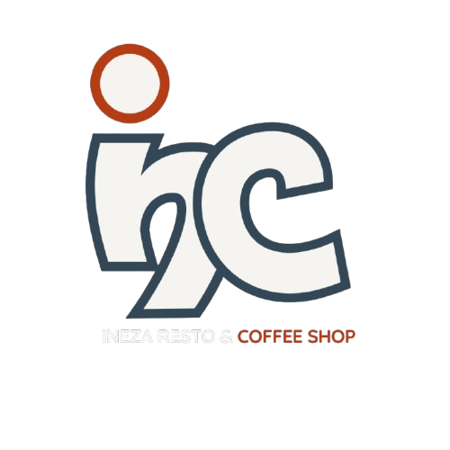

# INEZA RESTO & COFFEE SHOP - Smart Restaurant & Cafe Management Platform



[-orange?logo=pwa)](https://developer.mozilla.org/en-US/docs/Web/Progressive_web_apps)
[](https://www.php.net/)
[-green)](https://www.bnr.rw/)
[](https://www.rra.gov.rw/)
[](https://maps.google.com)

**INEZA RESTO & COFFEE SHOP** is a modern, high-performance Progressive Web Application (PWA) and restaurant management platform engineered specifically for Rwandan hospitality operations. Designed to eliminate high 15%–30% aggregator commission fees, it delivers a direct-to-consumer digital dining and ordering experience paired with a real-time Kitchen Display System (KDS), localized mobile payments, and fiscalized thermal receipting.

🌐 **Local Application URL:** [http://localhost/ineza_resto_cafe-shop/](http://localhost/ineza_resto_cafe-shop/)  
🛠️ **Kitchen & Management Portal:** [http://localhost/ineza_resto_cafe-shop/admin.html](http://localhost/ineza_resto_cafe-shop/admin.html)  
📱 **Mobile Dedicated PWA View:** [http://localhost/ineza_resto_cafe-shop/mobile_app.html](http://localhost/ineza_resto_cafe-shop/mobile_app.html)

---

## 🚀 Key Modules & Capabilities

### ☕ 1. Customer Ordering & Self-Service PWA (`index.html` & `mobile_app.html`)
- **Zero-Friction QR Table Ordering:** Diners scan on-table QR cards (`?table=X`) to immediately browse and order with automatic table assignment.
- **Dynamic Live Menu:** Filter by Hot Coffee, Iced Beverages, Breakfast, Bakery, Mains, and Chef Specials with instant stock badges.
- **Rwanda Localized Currency & Checkout:** Full native pricing in Rwandan Francs (`RWF`) with VAT calculation.
- **Mobile Money (MoMo) Gateway:** Pre-configured for MTN MoMo (`*182*8*1*004587*Amount#`), Airtel Money, and Cash on Delivery.
- **Live Order Timeline Tracker:** 4-stage tracking (`Pending` ➔ `Preparing` ➔ `Ready` ➔ `Delivered / Completed`) updating in real time.
- **Dark & Light Mode:** Universal synchronous theme toggle via `js/theme.js`.

### 👨‍🍳 2. Kitchen Display System (KDS) & Operations Hub (`admin.html`)
- **Live Ticket Dispatch Grid:** Visual color-coded kitchen tickets with item breakdowns, chef/server assignments, and instant status advance.
- **Table Dining Tracker:** Real-time floor plan tracker managing tables from Seated to Dining to Cleared.
- **RRA EBM v2.1 Thermal Receipts:** One-click generation of 80mm fiscalized thermal receipts featuring dynamic RRA verification QR codes.
- **Table QR Tent Card Generator:** Auto-generates high-resolution printable table cards for physical cafe tables.
- **Full Menu & Category CRUD:** Add, update, hide, or restock dishes, categories, and prices with instant sync to customer screens.

### 📊 3. Customer Analytics & Kigali Delivery Geolocation Map
- **Registered vs. Guest Donut Chart:** Interactive SVG chart illustrating customer conversion and retention ratios.
- **Kigali Neighborhood Heatmap & Density Tracker:** Interactive Leaflet map plotting active order locations across Kigali (Kimironko, Kacyiru, Nyarutarama, Gishushu, Remera, Kiyovu) with delivery revenue distribution metrics.
- **CSV & Excel Analytics Export:** Export comprehensive order breakdowns, customer cohorts, and financial summaries.

### 👥 4. Access Control, Roles & Permissions
- **Granular Staff Management:** Super Admin, Branch Manager, Cashier, Kitchen Chef, and Floor Waiter roles.
- **Customer Directory:** Full CRUD control for registered accounts with order histories and delivery landmarks.
- **Promotions & Banner Switcher:** Enable, disable, or schedule promotional announcement bars and discount coupon vouchers.

---

## 🛠️ Technology Stack

| Layer | Technology |
|---|---|
| **Frontend** | HTML5, Modern CSS3, JavaScript (ES6+), Bootstrap 5, FontAwesome 6 |
| **Maps & Charts** | Leaflet.js, OpenStreetMap Kigali Tiles, Custom SVG Charts |
| **PWA & Cache** | Service Worker (`sw.js`), Web App Manifest (`manifest.json`) |
| **Backend & API**| PHP 8.x REST API (`api/menu.php`, `api/orders.php`, `api/users.php`, `api/settings.php`) |
| **Database** | MySQL with automatic schema bootstrap (`api/db.php`) |
| **Compliance** | Rwanda Revenue Authority (RRA) EBM v2.1 Fiscal Receipt Standard |

---

## 💻 Local Setup & Installation

### 1. Requirements
- [XAMPP](https://www.apachefriends.org/) (Apache + MySQL + PHP 8.x) or equivalent local AMP stack.

### 2. Setup Steps
1. Clone or place this repository into your XAMPP root:
   ```bash
   git clone git@github.com:kayongest/ineza_resto_cafe-shop.git c:/xampp/htdocs/ineza_resto_cafe-shop
   ```
2. Start **Apache** and **MySQL** from your XAMPP Control Panel.
3. Open your browser and navigate to:
   - **Customer Portal:** `http://localhost/ineza_resto_cafe-shop/`
   - **Admin & KDS Panel:** `http://localhost/ineza_resto_cafe-shop/admin.html`
4. The database schema and initial tables are automatically initialized upon the first API request via `api/db.php`.

---

## 📍 Establishment & Fiscal Information

- **Establishment:** INEZA RESTO & COFFEE SHOP
- **Location:** 108 Kimironko St, Kigali - Rwanda
- **Taxpayer Identification (TIN):** 102938475
- **EBM Standard:** RRA EBM v2.1 (18% VAT included)
- **Direct Phone & WhatsApp:** +250 788 700 870 / +250 788 000 000

---

## 📄 License

This software is distributed under the [MIT License](LICENSE).
