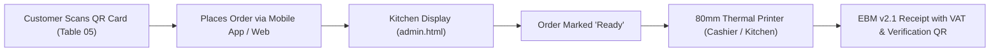

# Production Deployment, Infrastructure & Operations Plan
**INEZA RESTO & COFFEE SHOP**  
*Location: 108 Kimironko St, Kigali - Rwanda | TIN: 102938475*

---

## 1. Executive Summary & Deployment Objectives

This comprehensive plan outlines the end-to-end production readiness, infrastructure provisioning, and client handover for **INEZA RESTO & COFFEE SHOP**. The platform consists of:
- **Customer Web & Mobile PWA** ([`index.html`](file:///c:/xampp/htdocs/ineza_resto_cafe-shop/index.html) & [`mobile_app.html`](file:///c:/xampp/htdocs/ineza_resto_cafe-shop/mobile_app.html)) with table lock (`?table=X`) and instant MTN MoMo payment simulation (`*182*8*1*004587*Amount#`).
- **Kitchen Display System (KDS) & Administration** ([`admin.html`](file:///c:/xampp/htdocs/ineza_resto_cafe-shop/admin.html)).
- **Fiscal RRA EBM v2.1 80mm Thermal Receipt Generator & QR Table Tent Card Generator**.
- **PHP REST API & Local JSON / MySQL Dual-Sync Engine** (`api/`).

---

## 2. Work Stream 1: Hosting Architecture & Options Comparison

We analyze the three deployment topologies best suited for INEZA RESTO & COFFEE SHOP in Kigali:

| Dimension | Option A: Cloud VPS (DigitalOcean / Hetzner / AWS Lightsail) ⭐ *Recommended* | Option B: cPanel / Shared Hosting (Hostinger / local Rwanda host) | Option C: On-Premise Local Server (Mini PC / Raspberry Pi 5 + Cloud Sync) |
| :--- | :--- | :--- | :--- |
| **Monthly Cost** | ~\$6 – \$12 / month (approx. 8,000 – 16,000 RWF) | ~\$3 – \$7 / month (approx. 4,000 – 9,500 RWF) | One-time hardware (~150,000 – 250,000 RWF) + optional backup VPS |
| **Performance** | **Very High** (Dedicated vCPU, NVMe SSD, isolated RAM). | **Medium** (Shared resource pool; peak lunch rush could experience slow MySQL queries). | **Instant LAN speed** (<5ms response time inside the restaurant). |
| **Uptime & Accessibility** | 99.99% cloud uptime. Accessible worldwide for mobile online delivery orders & remote owners. | 99.9% uptime. Accessible worldwide. | Accessible locally only if internet cuts out; requires Cloudflare Tunnel for external delivery orders. |
| **Maintenance** | Docker or Ubuntu LAMP stack with automated daily snapshots & Let's Encrypt auto-renewal. | Simple file upload via FTP/cPanel File Manager; phpMyAdmin GUI. | Hardware maintenance on-site; requires local UPS battery backup against power outages. |
| **PWA & Offline Suitability** | Fully supported. Service Worker caches app shell on customer devices. | Fully supported. | Excellent local fallback, but setup is more complex. |

> [!TIP]
> **Recommended Strategy**: **Option A (Cloud VPS)** paired with **Cloudflare Free CDN** for public traffic, while leveraging the built-in PWA Service Worker caching on mobile phones for offline-first resilience.

---

## 3. Work Stream 2: Domain, SSL & DNS Setup (PWA & Hardware Camera Readiness)

HTTPS is strictly mandatory for modern Progressive Web Apps (PWAs). Without valid TLS/SSL:
1. Web browsers **block Service Worker registration** (`sw.js`).
2. Mobile browsers **deny camera access** for QR scanning.
3. Add to Home Screen ("Install App") prompt is suppressed.

### Implementation Blueprint:
1. **Domain Registration**:
   - Primary domain: `ineza.rw` or `inezacafe.com` (via RICTA for `.rw` or Cloudflare/Namecheap for `.com`).
2. **Cloudflare DNS Configuration**:
   - Root `A` record `inezacafe.com` -> pointing to server IP (Proxy Status: Proxied).
   - Subdomain `CNAME` `admin.inezacafe.com` or subdirectory routing to `admin.html`.
   - SSL/TLS encryption mode: **Full (Strict)**.
3. **Automated Let's Encrypt SSL via Certbot (Nginx/Apache)**:
   ```bash
   sudo apt install certbot python3-certbot-nginx -y
   sudo certbot --nginx -d inezacafe.com -d www.inezacafe.com
   ```
4. **Security & Header Enforcement (`.htaccess` / Nginx)**:
   - Force HTTPS redirect (`301 Moved Permanently`).
   - Enable HTTP Strict Transport Security (`HSTS`).
   - Configure Cross-Origin headers for PWA assets and broadcast channels.

---

## 4. Work Stream 3: Database Migration & Environment Configuration

Currently, [`api/db.php`](file:///c:/xampp/htdocs/ineza_resto_cafe-shop/api/db.php) uses hardcoded local XAMPP defaults (`localhost`, `root`, `""`). We need a production-grade configuration that supports both environment variables (`.env`) and automatic fallback.

### Key Deliverables:
1. **Production Schema Dump (`schema.sql`)**:
   - `users` (superadmin, manager, chef, cashier, waiter, customer roles, bcrypt password hashes).
   - `store_settings` (TIN: 102938475, MoMo merchant: 004587, VAT: 18%, location, opening hours).
   - `orders` & `order_items` (tables, status lifecycle, MoMo transaction refs, thermal receipt tokens).
   - `menu_items` & `categories` (pricing in RWF, availability toggles, image paths).
2. **Environment Variable Integration for [`api/db.php`](file:///c:/xampp/htdocs/ineza_resto_cafe-shop/api/db.php)**:
   - Reads `DB_HOST`, `DB_NAME`, `DB_USER`, `DB_PASS` from `.env` or system environment, with safe fallbacks.
   - Prevents database error leakage to customer JSON responses in production.

---

## 5. Work Stream 4: Thermal Printer & QR Table Tent Card Deployment

INEZA RESTO & COFFEE SHOP features a fiscal RRA EBM v2.1 80mm receipt generator and QR table lock stands.



### Hardware Deployment Steps:
1. **80mm ESC/POS Thermal Printer Setup**:
   - Models: Xprinter XP-N160II, Epson TM-T20III, or Sunmi V2 Pro handheld POS.
   - Connection interface: Ethernet (LAN) or USB connected to the cashier PC.
   - Browser Print Optimization: Set page width to **80mm (3.14in)**, margins to **None / 0mm**, enable *"Background Graphics"*, and configure auto-cutter trigger.
2. **QR Table Tent Card Batch Generation**:
   - Use the built-in QR generator in [`admin.html`](file:///c:/xampp/htdocs/ineza_resto_cafe-shop/admin.html) to render Table 01 through Table 20.
   - Format: Double-sided acrylic A6 tent cards (105mm × 148mm) featuring:
     - Prominent QR Code encoding `https://inezacafe.com/?table={XX}`
     - Visual instruction: *"Scan to view menu & order with MTN MoMo"*
     - Direct USSD fallback: `*182*8*1*004587#`

---

## 6. Work Stream 5: Client Handover & Staff Onboarding

To ensure frictionless daily operations from Day 1:

1. **Staff Roles & Access Credentials**:
   - **SuperAdmin / General Manager**: Full revenue dashboard, menu price editing, store settings, user accounts.
   - **Cashier / Receptionist**: Order approval, shift Z-Report printing, MoMo payment verification.
   - **Kitchen / Barista Staff (KDS)**: Tablet mounted in kitchen showing live color-coded tickets (`Pending` ➔ `Preparing` ➔ `Ready`).
2. **Rwanda MoMo Merchant Verification Flow**:
   - Establish cashier standard procedure: When an order is placed via MoMo, verify SMS notification on the official cafe merchant SIM (`TIN: 102938475 / Code: 004587`) against the order's generated MoMo Transaction Reference.
3. **Training & Operations Manual**:
   - Prepare a 1-page quick-start laminable guide for the kitchen and cashier desk.
   - Emergency offline operating guide (using local JSON storage fallback).

---

## 7. Phased Implementation Roadmap

1. **Phase 1: Production Database & Environment Config**:
   - Generate production `schema.sql` with all tables, constraints, and default Kigali cafe settings.
   - Refactor [`api/db.php`](file:///c:/xampp/htdocs/ineza_resto_cafe-shop/api/db.php) to support environment-based configuration.
2. **Phase 2: Web Server & HTTPS Security Hardening**:
   - Create production `.htaccess` / Nginx config for HTTPS redirection, PWA mime types, and caching headers.
   - Verify PWA [`manifest.json`](file:///c:/xampp/htdocs/ineza_resto_cafe-shop/manifest.json) and [`sw.js`](file:///c:/xampp/htdocs/ineza_resto_cafe-shop/sw.js) for live HTTPS environments.
3. **Phase 3: Hardware & Thermal Print Guide**:
   - Provide exact printer driver settings, 80mm CSS media print rules verification, and table QR tent card print-ready assets.
4. **Phase 4: Client Handover Kit & Staff Onboarding Cheatsheet**:
   - Generate operational staff guide (cashier shift closing, Z-report, MoMo matching, KDS workflow).

---

### User Decision Point
Please review the proposed plan. Once approved, we will begin with **Phase 1: Database Schema Export & Environment Credentials Configuration**.
